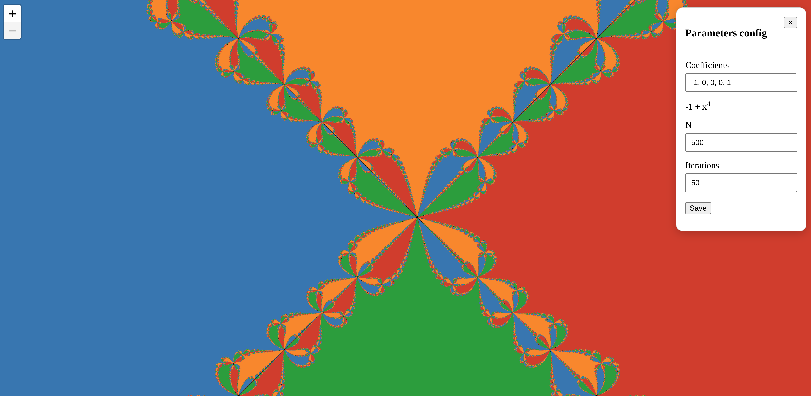
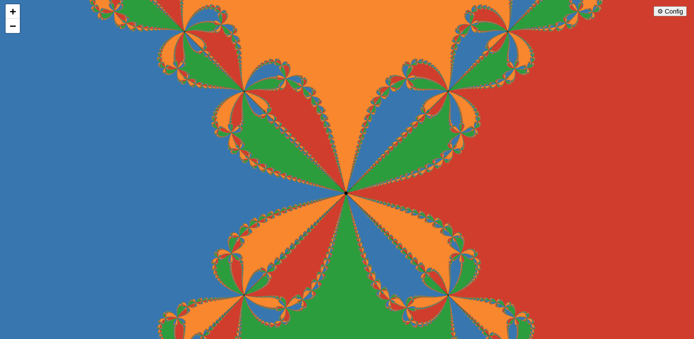
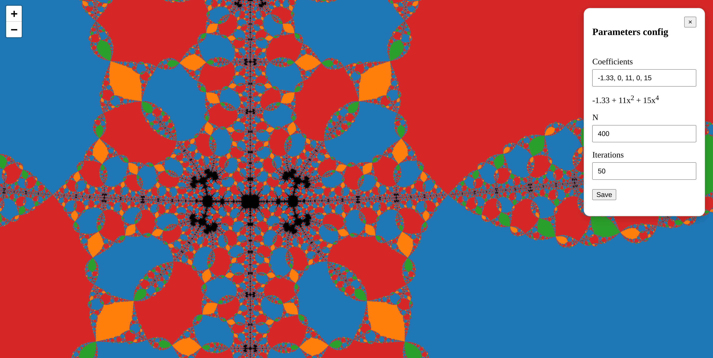
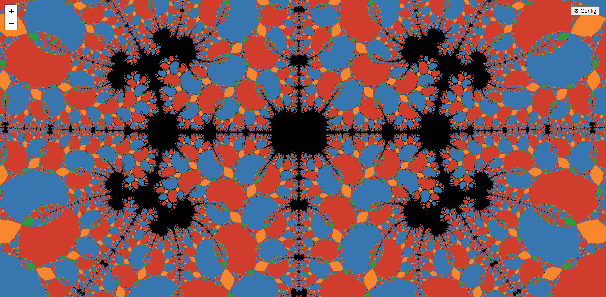
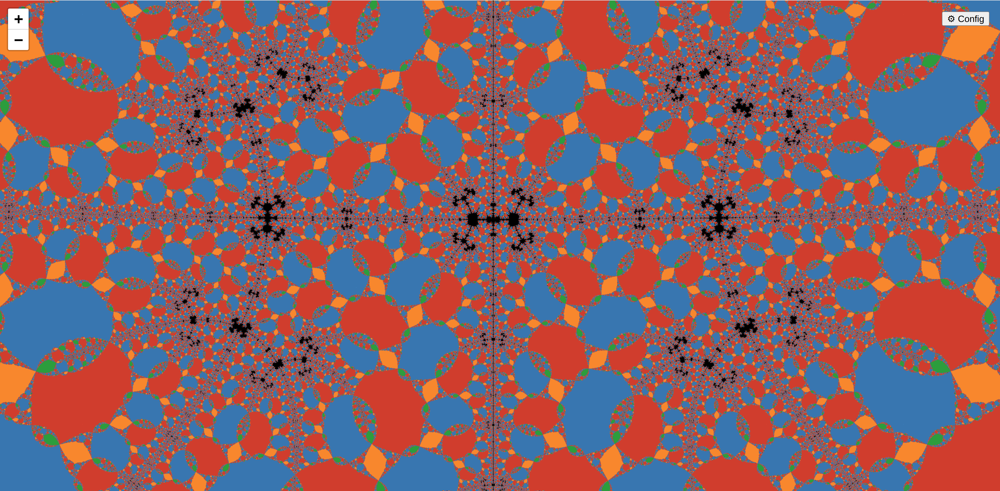

# Newton-Raphson method visualizer

A visualization tool for Newton's fractals - graphical representation of the Newton-Raphson method.

## Overview

This is an app allowing to dynamically visualize Newton's fractals.  

It supports all polynomials with real-valued coefficients, infinite canvas, interactive zooming.  
Also supports changing the number of iterations and dynamic resolution change in case the defaults are not well suited for your needs.

## Why I built this

Originally this started as a mini-project for a Distributed Computing course at Uni.
The idea of visualizing Newton's fractal is heavily inspired by an amazing video made by 
Grant Sanderson, aka 3B1B: [Newton's fractal (which Newton knew nothing about)](https://www.youtube.com/watch?v=-RdOwhmqP5s). I wholeheartedly recommend his whole channel btw!.

I liked the idea of fractal visualization so much that I started to dive deeper, looking for ways to produce the biggest and most detailed fractal possible.
Later I went for the more practical approach of interactive zoom instead of one big image, and that's how this project came to be.

## Features
The app features:
- ability to visualize Newton's fractals for any real-valued polynomials up to the degree of 10. Support for complex coefficients in progress!
- any number of Newton_Raphson iterations
- interactive rendering with deep zoom and panning
- dynamic resolution change

## How to use

The app can be self-deployed. **Docker deployment in progress.**  
It consists of a Python backend and Vite frontend. Currently to use it, you need to launch from source.

### The backend setup
Install Python and preferably create a separate virtual environment, for example using [venv](https://docs.python.org/3/library/venv.html).
Inside the virtual environment, there are two things to do:
1. install required dependencies by running `pip install -r requirements/http-server.txt`
2. run the server, provided entrypoint will start everything the backend needs: `python -m newton_raphson.server.main_server `

### The frontend setup
0. Install [Node.js](https://nodejs.org/en/download/)
1. change directory to `frontend/newton-raphson-frontend`
2. install all deps: `npm install`
3. run the app: `npm run dev`

After that you are ready to go! The frontend is available at http://localhost:5173.

### Usage
You can configure parameters in the panel in the right-upper corner. Polynomial coefficients are entered lowest-degree-first,
the preview will help with inputting the polynomial correctly. `N` parameter effectively represents resolution of the fractal.

PS: You can save new parameters by pressing enter, no need to click the button.

After configuring the parameters, you can close the config panel so it will not obstruct the image.  
By default, it displays a fractal that I particularly like. Enjoy the view!

## A few examples

The black spots represent points that have not converged to any root after the specified number of iterations.

The same spot, different number of iterations (50 vs 75):

<table>
  <tr>
    <td></td>
    <td></td>
  </tr>
</table>

## History
This part of the readme is still in development and will describe the legacy code.

---

PS: No AI was used to write this README (I hate reading AI-generated text so much it cannot be expressed with my English vocabulary).